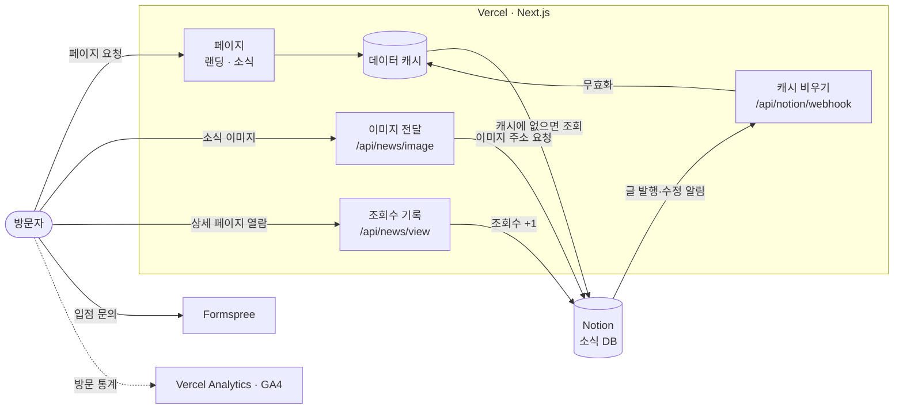

# ONFLEA 랜딩 페이지

패션 크리에이터의 협찬·촬영 의류를 판매·배송·정산까지 대행하는 온라인 플리마켓 **ONFLEA(온플리)** 의 회사 소개 사이트입니다.

- 사이트: https://corp.onflea.kr
- 쇼핑몰: https://onfleashop.imweb.me (아임웹으로 운영하며 이 저장소에는 포함되지 않습니다)

## 기술 스택

| 구분       | 사용                                          |
| ---------- | --------------------------------------------- |
| 프레임워크 | Next.js 14 (App Router), React 18, TypeScript |
| 스타일     | Tailwind CSS 3                                |
| 콘텐츠     | Notion API (소식 글 CMS)                      |
| 폼         | Formspree (입점 문의)                         |
| 분석       | Vercel Analytics, Google Analytics 4          |
| 배포       | Vercel                                        |

## 주요 기능

- **서비스 소개:** 크리에이터와 구매자 각각에게 서비스를 설명하는 랜딩 페이지
- **입점 문의:** 문의 폼을 Formspree로 전송합니다. `?apply=1`이 붙은 링크로 들어오면 문의 창이 바로 열립니다.
- **소식(NEWS):** 노션 DB에 글을 쓰고 상태를 `발행 완료`로 바꾸면 사이트에 올라갑니다.
- **SEO:** 페이지별 공유 미리보기, 발행된 소식 글이 포함된 사이트맵

## 아키텍처



- 페이지는 Vercel에서 Next.js로 만들고, 소식 데이터는 노션 API에서 가져와 캐시합니다.
- 노션에서 글을 발행하거나 고치면 노션 웹훅이 캐시를 비워서 사이트에 바로 반영됩니다.
- 노션에 올린 이미지 주소는 1시간 뒤 만료되므로, 이미지는 사이트 주소(`/api/news/image`)를 거쳐 전달합니다.
- 입점 문의는 서버를 거치지 않고 브라우저에서 Formspree로 바로 보냅니다.

## 로컬 실행

Node.js 18.17 이상이 필요합니다.

```bash
npm install
npm run dev   # http://localhost:3000
```

환경변수는 `.env.local`에 둡니다.

| 이름                    | 설명                                                                                         |
| ----------------------- | -------------------------------------------------------------------------------------------- |
| `NOTION_TOKEN`          | 노션 통합 토큰. 없으면 소식 영역이 숨겨집니다.                                               |
| `NOTION_WEBHOOK_SECRET` | 노션 웹훅 서명 검증 키. 등록 방법은 `src/app/api/notion/webhook/route.ts` 주석을 참고하세요. |
| `NEXT_PUBLIC_GA_ID`     | GA4 측정 ID (선택)                                                                           |

## 노션 소식 DB

| 속성     | 유형 | 설명                                                 |
| -------- | ---- | ---------------------------------------------------- |
| 글 제목  | 제목 |                                                      |
| 카테고리 | 선택 | 비어 있으면 `공지`                                   |
| 발행일   | 날짜 | 정렬 기준                                            |
| 상태     | 상태 | `발행 완료`인 글만 노출                              |
| 조회수   | 숫자 | 상세 페이지 열람 수 (선택, 사이트에는 표시하지 않음) |

페이지 커버 이미지는 목록 썸네일과 공유 미리보기 이미지로 쓰입니다.
